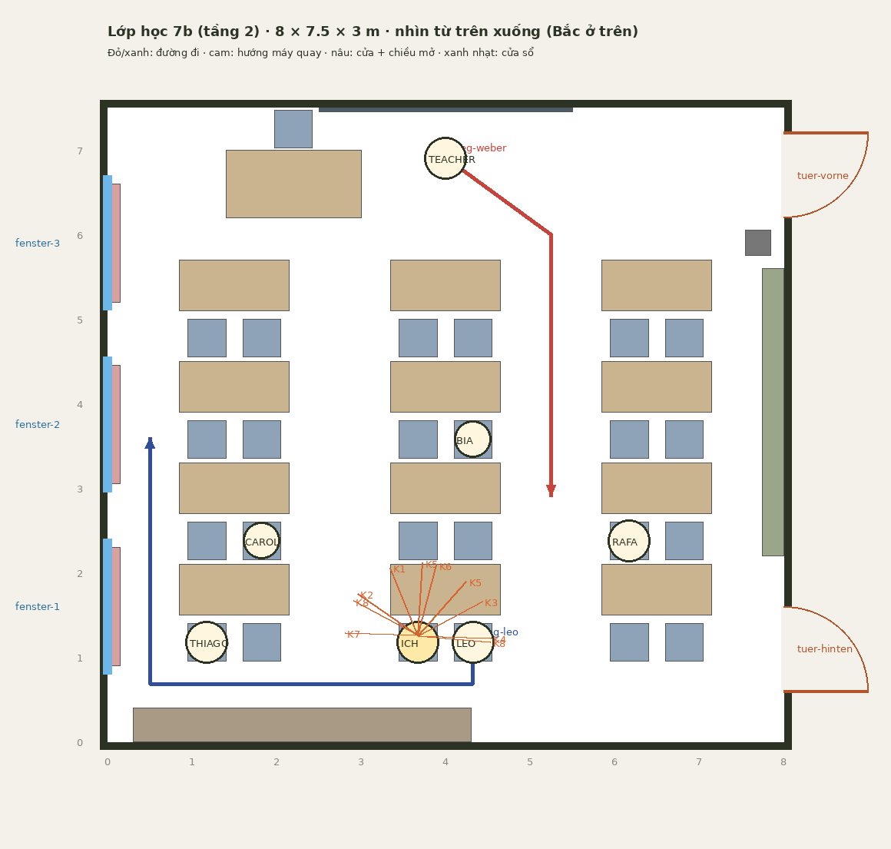

# Mặt bằng: Lớp học 7b (tầng 2)

> File này được **sinh tự động** từ `plan.json` bởi `scripts/plan_tool.py`. Muốn sửa thì sửa `plan.json` rồi chạy lại công cụ.

## Kết quả kiểm tra

✅ Không có va chạm: không đường đi nào xuyên tường hay đồ đạc, cửa mở không va đồ, máy quay không nằm trong vật thể.

## Kích thước & hệ toạ độ

- Kích thước phòng: **8,00 m (rộng, Tây→Đông) × 7,50 m (sâu, Nam→Bắc) × 3,00 m (cao)**
- Gốc toạ độ: Góc Tây-Nam (góc sau bên trái nhìn từ chỗ học sinh); trục x hướng Đông, trục y hướng Bắc (về phía bảng), trục z hướng lên
- Hướng máy quay (yaw): 0° = Bắc (nhìn lên bảng), +90° = Đông (phía cửa ra vào), −90° = Tây (phía cửa sổ)

## Tường

| ID | Tường | Từ → Đến (m) | Dày | Vật liệu | Ghi chú |
|---|---|---|---|---|---|
| nord | Tường Bắc (tường có bảng) | (0,00; 7,50) → (8,00; 7,50) | 0,17 m | trát vữa, xám xanh nhạt | Bảng trắng; đồng hồ phía trên bảng (giữa x 4,0 m, cao 2,50 m) |
| ost | Tường Đông (giáp hành lang) | (8,00; 7,50) → (8,00; 0,00) | 0,17 m | trát vữa | Hai cửa ra hành lang, móc áo ở giữa |
| sued | Tường Nam (tường sau lớp) | (8,00; 0,00) → (0,00; 0,00) | 0,17 m | trát vữa, bảng ghim phía trên tủ | Dãy tủ; bảng ghim cao 1,20–2,20 m |
| west | Tường Tây (tường cửa sổ, tường ngoài) | (0,00; 0,00) → (0,00; 7,50) | 0,30 m | tường ngoài nhà | Ba cửa sổ nhìn ra sân trường; máy bay phản lực bay qua phía này |

## Cửa ra vào

| ID | Tường | Vị trí (tâm) | Rộng × cao | Bản lề | **Hướng mở** | Ghi chú |
|---|---|---|---|---|---|---|
| tuer-vorne | ost | y = 6,70 m | 1,00 × 2,10 m | phía Bắc | **ra ngoài (về phía hành lang)** | Hướng thoát hiểm; tay nắm ở phía Nam, ô kính 0,3 × 0,6 m |
| tuer-hinten | ost | y = 1,10 m | 1,00 × 2,10 m | phía Nam | **ra ngoài (về phía hành lang)** | Lối thoát hiểm thứ hai; tay nắm ở phía Bắc |

## Cửa sổ

| ID | Tường | Vị trí (tâm) | Rộng × cao | Bậu cửa | Cách mở | Nhìn ra |
|---|---|---|---|---|---|---|
| fenster-1 | west | y = 1,60 m | 1,60 × 1,60 m | 0,85 m | Cửa mở quay/lật, cánh mở vào trong (bán kính 0,80 m, cao hơn mặt bàn) | Sân trường, cột bóng rổ, dãy nhà |
| fenster-2 | west | y = 3,75 m | 1,60 × 1,60 m | 0,85 m | Cửa mở quay/lật, cánh mở vào trong (bán kính 0,80 m, cao hơn mặt bàn) | Sân trường, sân thể thao, bầu trời trống – góc nhìn chính thấy máy bay |
| fenster-3 | west | y = 5,90 m | 1,60 × 1,60 m | 0,85 m | Cửa mở quay/lật, cánh mở vào trong (bán kính 0,80 m, cao hơn mặt bàn) | Tán cây, bầu trời, vệt khói máy bay |

## Cầu thang

- Không có. Trong phòng không có cầu thang. Cầu thang nằm ngoài hành lang, cách cửa trước khoảng 6 m về phía Bắc (sẽ có plan riêng khi có cảnh diễn ra ở đó).

## Đồ nội thất (từng món)

| ID | Loại | x từ–đến (m) | y từ–đến (m) | Cao | Ghi chú |
|---|---|---|---|---|---|
| tisch-r1-s1 | Bàn học sinh (bàn đôi) | 0,85–2,15 | 5,10–5,70 | 0,76 m |  |
| stuhl-r1-s1-l | Ghế học sinh | 0,95–1,40 | 4,55–5,00 | 0,82 m | chỗ ngồi (1,18; 4,78) |
| stuhl-r1-s1-r | Ghế học sinh | 1,60–2,05 | 4,55–5,00 | 0,82 m | chỗ ngồi (1,82; 4,78) |
| tisch-r1-s2 | Bàn học sinh (bàn đôi) | 3,35–4,65 | 5,10–5,70 | 0,76 m |  |
| stuhl-r1-s2-l | Ghế học sinh | 3,45–3,90 | 4,55–5,00 | 0,82 m | chỗ ngồi (3,67; 4,78) |
| stuhl-r1-s2-r | Ghế học sinh | 4,10–4,55 | 4,55–5,00 | 0,82 m | chỗ ngồi (4,33; 4,78) |
| tisch-r1-s3 | Bàn học sinh (bàn đôi) | 5,85–7,15 | 5,10–5,70 | 0,76 m |  |
| stuhl-r1-s3-l | Ghế học sinh | 5,95–6,40 | 4,55–5,00 | 0,82 m | chỗ ngồi (6,17; 4,78) |
| stuhl-r1-s3-r | Ghế học sinh | 6,60–7,05 | 4,55–5,00 | 0,82 m | chỗ ngồi (6,83; 4,78) |
| tisch-r2-s1 | Bàn học sinh (bàn đôi) | 0,85–2,15 | 3,90–4,50 | 0,76 m |  |
| stuhl-r2-s1-l | Ghế học sinh | 0,95–1,40 | 3,35–3,80 | 0,82 m | chỗ ngồi (1,18; 3,58) |
| stuhl-r2-s1-r | Ghế học sinh | 1,60–2,05 | 3,35–3,80 | 0,82 m | chỗ ngồi (1,82; 3,58) |
| tisch-r2-s2 | Bàn học sinh (bàn đôi) | 3,35–4,65 | 3,90–4,50 | 0,76 m |  |
| stuhl-r2-s2-l | Ghế học sinh | 3,45–3,90 | 3,35–3,80 | 0,82 m | chỗ ngồi (3,67; 3,58) |
| stuhl-r2-s2-r | Ghế học sinh | 4,10–4,55 | 3,35–3,80 | 0,82 m | chỗ ngồi (4,33; 3,58) |
| tisch-r2-s3 | Bàn học sinh (bàn đôi) | 5,85–7,15 | 3,90–4,50 | 0,76 m |  |
| stuhl-r2-s3-l | Ghế học sinh | 5,95–6,40 | 3,35–3,80 | 0,82 m | chỗ ngồi (6,17; 3,58) |
| stuhl-r2-s3-r | Ghế học sinh | 6,60–7,05 | 3,35–3,80 | 0,82 m | chỗ ngồi (6,83; 3,58) |
| tisch-r3-s1 | Bàn học sinh (bàn đôi) | 0,85–2,15 | 2,70–3,30 | 0,76 m |  |
| stuhl-r3-s1-l | Ghế học sinh | 0,95–1,40 | 2,15–2,60 | 0,82 m | chỗ ngồi (1,18; 2,38) |
| stuhl-r3-s1-r | Ghế học sinh | 1,60–2,05 | 2,15–2,60 | 0,82 m | chỗ ngồi (1,82; 2,38) |
| tisch-r3-s2 | Bàn học sinh (bàn đôi) | 3,35–4,65 | 2,70–3,30 | 0,76 m |  |
| stuhl-r3-s2-l | Ghế học sinh | 3,45–3,90 | 2,15–2,60 | 0,82 m | chỗ ngồi (3,67; 2,38) |
| stuhl-r3-s2-r | Ghế học sinh | 4,10–4,55 | 2,15–2,60 | 0,82 m | chỗ ngồi (4,33; 2,38) |
| tisch-r3-s3 | Bàn học sinh (bàn đôi) | 5,85–7,15 | 2,70–3,30 | 0,76 m |  |
| stuhl-r3-s3-l | Ghế học sinh | 5,95–6,40 | 2,15–2,60 | 0,82 m | chỗ ngồi (6,17; 2,38) |
| stuhl-r3-s3-r | Ghế học sinh | 6,60–7,05 | 2,15–2,60 | 0,82 m | chỗ ngồi (6,83; 2,38) |
| tisch-r4-s1 | Bàn học sinh (bàn đôi) | 0,85–2,15 | 1,50–2,10 | 0,76 m |  |
| stuhl-r4-s1-l | Ghế học sinh | 0,95–1,40 | 0,95–1,40 | 0,82 m | chỗ ngồi (1,18; 1,18) |
| stuhl-r4-s1-r | Ghế học sinh | 1,60–2,05 | 0,95–1,40 | 0,82 m | chỗ ngồi (1,82; 1,18) |
| tisch-r4-s2 | Bàn học sinh (bàn đôi) | 3,35–4,65 | 1,50–2,10 | 0,76 m |  |
| stuhl-r4-s2-l | Ghế học sinh | 3,45–3,90 | 0,95–1,40 | 0,82 m | chỗ ngồi (3,67; 1,18) |
| stuhl-r4-s2-r | Ghế học sinh | 4,10–4,55 | 0,95–1,40 | 0,82 m | chỗ ngồi (4,33; 1,18) |
| tisch-r4-s3 | Bàn học sinh (bàn đôi) | 5,85–7,15 | 1,50–2,10 | 0,76 m |  |
| stuhl-r4-s3-l | Ghế học sinh | 5,95–6,40 | 0,95–1,40 | 0,82 m | chỗ ngồi (6,17; 1,18) |
| stuhl-r4-s3-r | Ghế học sinh | 6,60–7,05 | 0,95–1,40 | 0,82 m | chỗ ngồi (6,83; 1,18) |
| lehrertisch | Bàn giáo viên | 1,40–3,00 | 6,20–7,00 | 0,76 m |  |
| lehrerstuhl | Ghế giáo viên (ghế xoay) | 1,98–2,43 | 7,02–7,47 | 1,00 m | chỗ ngồi (2,20; 7,25) |
| tafel | Bảng trắng (treo tường, mép dưới cao 0,90 m) | 2,50–5,50 | 7,45–7,50 | 2,10 m |  |
| schraenke | Dãy tủ (4 tủ × 1,00 m) | 0,30–4,30 | 0,00–0,40 | 1,00 m |  |
| garderobe | Móc treo áo khoác trên tường | 7,75–8,00 | 2,20–5,60 | 1,70 m |  |
| muelleimer | Thùng rác | 7,55–7,85 | 5,75–6,05 | 0,45 m |  |
| heizkoerper-1 | Lò sưởi dưới cửa sổ | 0,00–0,15 | 0,90–2,30 | 0,60 m |  |
| heizkoerper-2 | Lò sưởi dưới cửa sổ | 0,00–0,15 | 3,05–4,45 | 0,60 m |  |
| heizkoerper-3 | Lò sưởi dưới cửa sổ | 0,00–0,15 | 5,20–6,60 | 0,60 m |  |

## Nhân vật & vị trí

| Nhân vật | Figur | Vị trí (x; y) | Chỗ | Bán kính thân | Ghi chú |
|---|---|---|---|---|---|
| ICH | pov | (3,67; 1,18) | stuhl-r4-s2-l | 0,25 m | Học sinh góc nhìn POV, hàng cuối giữa lớp, tầm mắt khi ngồi 1,15 m |
| TEACHER | weber | (4,00; 6,90) | đứng | 0,25 m | Đứng trước bảng |
| CAROL | carol | (1,82; 2,38) | stuhl-r3-s1-r | 0,22 m | Dãy cạnh cửa sổ, ngay cạnh cửa sổ 2 |
| RAFA | rafa | (6,17; 2,38) | stuhl-r3-s3-l | 0,25 m | Phía trước bên phải ICH |
| LEO | leo | (4,33; 1,18) | stuhl-r4-s2-r | 0,25 m | Bạn cùng bàn bên phải ICH |
| BIA | bia | (4,33; 3,58) | stuhl-r2-s2-r | 0,22 m | Ngồi trước ICH hai hàng, quay người lại |
| THIAGO | thiago | (1,18; 1,18) | stuhl-r4-s1-l | 0,25 m | Góc cuối lớp cạnh cửa sổ |

## Đồ đạc di chuyển trong cảnh

| Đồ | Lúc | Dịch chuyển | Lý do |
|---|---|---|---|
| stuhl-r4-s2-r | 20,60 s | x +0.52 m, y +0.00 m | Leo đẩy ghế sang lối đi bên phải khi bật dậy |

## Xoay người khi ngồi

Khi ngồi, chỉ thân trên + đầu xoay; nếu cần quay hẳn người thì chân xoay ra phía có lối đi trống (đã kiểm tra không chạm bàn).

- **CAROL:** thân trên +0,75 rad về phía cửa sổ (giật mình lúc 4,0 s)
- **RAFA:** chân xoay sang Tây ra lối đi (x 5,25 trống), thân trên +0,42 rad, đầu quay về ICH
- **LEO:** chân giữ dưới bàn, thân trên +0,9 rad về phía ICH
- **BIA:** chân xoay sang Đông ra lối đi (x 5,25 trống), thân trên −1,2 rad về phía ICH
- **THIAGO:** thân trên +0,55 rad, đầu +0,4 rad về phía cửa sổ

## Đường di chuyển

Mỗi đường được kiểm tra theo từng cm, tính cả bán kính thân người: không được chạm tường (trừ khi đi qua cửa) và không được chạm đồ đạc.

| ID | Ai | Câu thoại | Thời gian | Các điểm (x; y) | Dài | Kiểm tra | Mô tả |
|---|---|---|---|---|---|---|---|
| weg-weber | TEACHER | 05 | trong câu 05 (≈ 3 s, đi chậm, dứt khoát) | (4,00; 6,90) → (5,25; 6,00) → (5,25; 2,90) | 4,64 m | ✅ | Từ bảng đi xuống lối giữa dãy 2 và dãy 3, tới chỗ Rafa/Leo |
| weg-leo | LEO | 08 | từ câu 08 (≈ 2,5 s, chạy) | (4,33; 1,18) → (4,33; 0,68) → (0,50; 0,68) → (0,50; 3,60) | 7,24 m | ✅ | Bật dậy, đẩy ghế ra sau, chạy dọc phía sau hàng cuối tới tường cửa sổ, rồi lên phía trước tới cửa sổ 2 |

## Vị trí máy quay theo từng góc quay

Toàn bộ là góc nhìn thứ nhất (POV) với ống kính fisheye 0.5x (góc ngang 120°).

| Góc | Câu | Thời gian | Vị trí (x; y; z) | Yaw | Pitch | FOV | Nhân vật trong khung | Thấy gì | Tay làm gì |
|---|---|---|---|---|---|---|---|---|---|
| K1 | Intro + 01 | 0,0–4,5 s | (3,67; 1,25; 1,15) | -22° | -14° | 120° | TEACHER (+3°), CAROL (-59°), BIA (+16°) | Điện thoại trong hai tay ở dưới khung hình (cảnh báo EXTREME GEFAHR), cô Weber ở bảng, cửa sổ 2 và 3 có máy bay (nguy hiểm thấy ngay ở khung hình 0) | cầm điện thoại đang rung |
| K2 | 02 Carol | – | (3,67; 1,25; 1,15) | -55° | -6° | 120° | TEACHER (+3°), CAROL (-59°), THIAGO (-92°) | Carol giật mình, phía sau là cửa sổ 2 | ngón cái trên màn hình điện thoại |
| K3 | 03 Rafa | – | (3,67; 1,25; 1,15) | +62° | -6° | 120° | TEACHER (+3°), RAFA (+66°), LEO (+97°), BIA (+16°) | Rafa quay lại, giơ điện thoại lên | điện thoại hạ xuống một nửa |
| K4 | 04 Leo | – | (3,67; 1,25; 1,15) | +92° | -12° | 120° | RAFA (+66°), LEO (+97°) | Leo rất gần (0,65 m), ngả người ra sau | điện thoại đặt trên bàn |
| K5 | 05 Weber | – | (3,67; 1,25; 1,15) | +4° → +42° | -2° | 120° | TEACHER (+3°), RAFA (+66°), LEO (+97°), BIA (+16°) | Máy quay bám theo cô Weber đi dọc lối đi (weg-weber) | đẩy điện thoại xuống gầm bàn |
| K6 | 06 Bia | – | (3,67; 1,25; 1,15) | +15° | -4° | 120° | TEACHER (+3°), RAFA (+66°), BIA (+16°) | Bia xoay người trên ghế, chìa màn hình ra | giơ điện thoại lên lại |
| K7 | 07 Thiago | – | (3,67; 1,25; 1,15) | -88° | -4° | 120° | CAROL (-59°), THIAGO (-92°) | Thiago bên trái, nghiêng đầu về phía cửa sổ | một tay bám mép bàn |
| K8 | 08 Leo | – | (3,67; 1,25; 1,15) | +95° → +298° | +2° | 120° | CAROL (-59°), RAFA (+66°), LEO (+97°), THIAGO (-92°) | Leo bật dậy; máy quay xoay QUA PHÍA SAU (180°) bám theo Leo chạy sau hàng cuối tới cửa sổ 2 (weg-leo); lượt bay thứ 2 của máy bay ngoài cửa sổ | nắm chặt mép bàn |

## Bên ngoài

- **jet:** Máy bay chiến đấu bay thấp: lượt 1 từ Nam lên Bắc (0,0–4,5 s), song song tường Tây, cách tường 60 m, cao 20 m so với mặt đất (phòng ở tầng 2, sàn cao 6 m). Từ chỗ ICH thấy qua cửa sổ 1 → 2 → 3 ngay từ khung hình 0. Tiếng nổ lúc 4,0 s. Lượt 2 từ Bắc xuống Nam (21,5–25 s), thấy qua cửa sổ 2 khi máy quay bám theo Leo.
