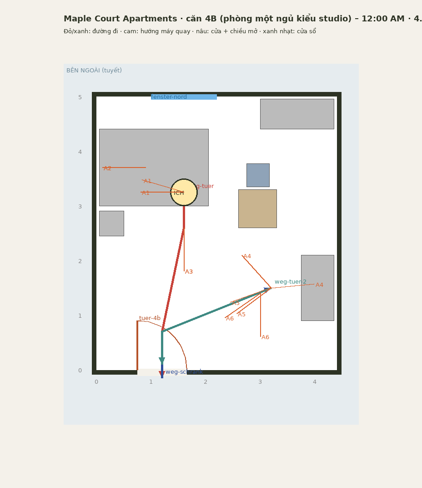

# Mặt bằng: Maple Court Apartments · căn 4B (phòng một ngủ kiểu studio) – 12:00 AM

> File này được **sinh tự động** từ `plan.json` bởi `scripts/plan_tool.py`. Muốn sửa thì sửa `plan.json` rồi chạy lại công cụ.

## Kết quả kiểm tra

✅ Không có va chạm: không đường đi nào xuyên tường hay đồ đạc, cửa mở không va đồ, máy quay không nằm trong vật thể.

## Kích thước & hệ toạ độ

- Kích thước phòng: **4,40 m (rộng, Tây→Đông) × 5,00 m (sâu, Nam→Bắc) × 2,60 m (cao)**
- Gốc toạ độ: Góc Tây-Nam trong căn hộ (sàn = 0). x về phía Đông, y về phía Bắc, z lên. Trong sơ đồ hành lang (maple-court-flur4), góc này nằm ở x = 5,0 m, y = 1,8 m (+ tường 0,15 m).
- Hướng máy quay (yaw): 0° = Bắc (cửa sổ, bãi đỗ xe), +90° = Đông (tủ quần áo), −90° = Tây (tường chung với 4C, đầu giường), ±180° = Nam (cửa ra hành lang)

## Tường

| ID | Tường | Từ → Đến (m) | Dày | Vật liệu | Ghi chú |
|---|---|---|---|---|---|
| west | Tường Tây – tường CHUNG với 4C (nơi phát ra ba tiếng gõ) | (0,00; 0,00) → (0,00; 5,00) | 0,12 m | thạch cao trên khung gỗ, sơn màu kem đã ố | Khung ảnh của người thuê trước (0,45 × 0,35 m) treo ở y = 3,7 m, cao 1,45 m – nảy lên theo từng tiếng gõ. Đầu giường áp vào đây. Không có ổ cắm, không có lỗ – kẻ theo dõi KHÔNG nhìn qua tường mà qua đầu báo khói. |
| nord | Tường Bắc (tường ngoài nhà) | (0,00; 5,00) → (4,40; 5,00) | 0,30 m | gạch, trát vữa | Cửa sổ nhìn ra bãi đỗ xe sau nhà; bếp nhỏ ở góc Đông-Bắc |
| ost | Tường Đông (giáp hộp kỹ thuật: ống nước, ống gió) | (4,40; 0,00) → (4,40; 5,00) | 0,15 m | thạch cao | Tủ quần áo âm tường, mẩu giấy vàng dán trên khung cửa tủ |
| sued | Tường Nam (giáp hành lang tầng 4) | (0,00; 0,00) → (4,40; 0,00) | 0,15 m | thạch cao, ván chân tường gỗ | Cửa chính ra hành lang; mắt thần ở cao 1,55 m; móc xích cửa |

## Cửa ra vào

| ID | Tường | Vị trí (tâm) | Rộng × cao | Bản lề | **Hướng mở** | Ghi chú |
|---|---|---|---|---|---|---|
| tuer-4b | sued | x = 1,20 m | 0,90 × 2,03 m | phía Tây | **vào trong căn hộ (kiểu cửa căn hộ Mỹ), cánh quay về phía Tây** | Cửa gỗ sơn nâu, số 4B bằng đồng; khoá chốt + xích. Phía sau cửa: hành lang tầng 4, nhìn thẳng sang cửa 4A của Rosa (lệch Đông 0,2 m). |

## Cửa sổ

| ID | Tường | Vị trí (tâm) | Rộng × cao | Bậu cửa | Cách mở | Nhìn ra |
|---|---|---|---|---|---|---|
| fenster-nord | nord | x = 1,60 m | 1,20 × 1,25 m | 0,90 m | Cửa sổ kéo lên xuống (double-hung), cánh không mở vào trong | Bãi đỗ xe sau nhà dưới ánh đèn natri cam, hai xe cũ phủ sương giá, bên kia đường là biển neon 'SUDS 24 HR LAUNDRY' (tiệm giặt đêm), cây phong trụi lá |

## Cầu thang

- Không có. Không có cầu thang trong căn hộ. Cầu thang chính ở đầu Đông hành lang (xem maple-court-flur4).

## Đồ nội thất (từng món)

| ID | Loại | x từ–đến (m) | y từ–đến (m) | Cao | Ghi chú |
|---|---|---|---|---|---|
| bett | Giường đôi (đầu giường áp tường Tây) | 0,05–2,05 | 3,00–4,40 | 0,55 m | chỗ ngồi (1,60; 3,25) |
| nachttisch | Tủ đầu giường | 0,05–0,50 | 2,45–2,90 | 0,60 m | Đèn ngủ chụp vải vàng (nguồn sáng ấm duy nhất lúc đầu), cốc nước |
| schrank | Tủ quần áo âm tường (2 cánh trượt) | 3,75–4,35 | 0,90–2,10 | 2,10 m | Mẩu giấy vàng 7,5 × 7,5 cm dán trên khung cửa tủ ở cao 1,6 m, phía Tây: 'IT'S NOT A SMOKE DETECTOR. – J'. Thấy từ giường ở khoảng 10 s (chữ quá nhỏ để đọc). |
| tisch | Bàn ăn nhỏ | 2,60–3,30 | 2,60–3,30 | 0,75 m | Hộp các-tông chưa bóc (mới dọn vào 6 ngày), hoá đơn tiền cọc $1,300 |
| stuhl | Ghế gỗ | 2,75–3,17 | 3,35–3,77 | 0,85 m |  |
| kueche | Bếp nhỏ (tủ bếp + bồn rửa) | 3,00–4,35 | 4,40–4,95 | 0,90 m | Tủ lạnh nhỏ kêu ù ù (có nguồn: thấy được tủ lạnh) – chỉ dùng khi khung hình thấy nó |

## Nhân vật & vị trí

| Nhân vật | Figur | Vị trí (x; y) | Chỗ | Bán kính thân | Ghi chú |
|---|---|---|---|---|---|
| ICH | pov | (1,60; 3,25) | bett | 0,25 m | TÔI, ~22, hoodie xanh lá. Ngồi mép giường, quay mặt về tường Tây; tầm mắt khi ngồi 1,05 m, khi đứng 1,60 m. |

## Đường di chuyển

Mỗi đường được kiểm tra theo từng cm, tính cả bán kính thân người: không được chạm tường (trừ khi đi qua cửa) và không được chạm đồ đạc.

| ID | Ai | Câu thoại | Thời gian | Các điểm (x; y) | Dài | Kiểm tra | Mô tả |
|---|---|---|---|---|---|---|---|
| weg-tuer | ICH | 08 | 31,8–33,2 s | (1,60; 3,25) → (1,60; 2,60) → (1,20; 0,70) → (1,20; -0,15) | 3,44 m | ✅ | Đứng dậy, đi ra cửa, tay trái mở chốt, tay phải cầm điện thoại bật đèn pin. 5 bước (sàn gỗ cũ, kêu cót két). |
| weg-schrank | ICH | 13–14 | 61,0–63,0 s | (1,20; -0,15) → (1,20; 0,70) → (3,20; 1,50) | 3,00 m | ✅ | Vào lại, khép cửa sau lưng (tay trái đẩy cửa), đi thẳng tới tủ quần áo. 4 bước. |
| weg-tuer-2 | ICH | 18–19 | 76,1–78,1 s | (3,20; 1,50) → (1,20; 0,70) → (1,20; 0,45) | 2,40 m | ✅ | Sau tiếng 'rầm': lao ra cửa, giật cửa mở, đứng ở ngưỡng cửa. 4 bước nhanh. |
| weg-schwelle | ICH | (khoảng lặng trước 19) | 85,3–86,1 s | (1,20; 0,45) → (1,20; -0,33) | 0,78 m | ✅ | Sau tiếng 'rầm': mở cửa, 2 bước ra đứng ở ngưỡng cửa 4B (bước chân nằm sau tiếng rầm, trước câu 19). |

## Vị trí máy quay theo từng góc quay

Toàn bộ là góc nhìn thứ nhất (POV) với ống kính fisheye 0.5x (góc ngang 120°).

| Góc | Câu | Thời gian | Vị trí (x; y; z) | Yaw | Pitch | FOV | Nhân vật trong khung | Thấy gì | Tay làm gì |
|---|---|---|---|---|---|---|---|---|---|
| A1 | 01–05 | 0,0–21,0 s | (1,60; 3,25; 1,05) | -74° → -90° | +0° | 115° | – | GIỮA KHUNG: tường Tây với khung ảnh đang nảy (khung 0). ~8 s: ngẩng lên trần (pitch +50, yaw −20) – đầu báo khói nháy đỏ, 1,5 s. ~10 s: liếc sang phải (yaw +125) – mẩu giấy vàng trên khung tủ, 1 s, rồi quay lại tường. Không giữ yên quá 8 s: nhún nhẹ theo nhịp thở. | Tay trái cầm điện thoại sáng '12:00 AM' (gọi Pruitt, bật loa, ở góc dưới phải theo quy tắc); tay phải nắm mép chăn, rồi chống lên giường khi nghiêng người về tường. |
| A2 | 06–08 | 21,0–31,6 s | (0,90; 3,70; 1,15) | -90° → -90° | -10° | 115° | – | GIỮA KHUNG: tường Tây cận hơn (quỳ trên giường). 21,0–23,0: khớp tay phải gõ 3 lần vào tường, rồi điện thoại rung. 23–29: cúi xuống đọc tin nhắn (pitch −35); ở mép trên khung, đèn đỏ đầu báo khói nháy đúng lúc tin nhắn đến (người xem thấy, TÔI không thấy). 'Nice green hoodie' → nhìn xuống tay áo xanh của mình. | Tay phải gõ tường rồi kéo tay áo hoodie; tay trái cầm điện thoại. |
| A3 | 08 | 31,6–33,2 s | (1,60; 2,60; 1,60) | +180° → +180° | -5° | 115° | – | GIỮA KHUNG: cửa 4B; camera nhún theo mỗi bước; tay mở chốt. | Tay trái vặn chốt, mở cửa vào trong; tay phải đèn pin. |
| A4 | 14–16 | 61,0–76,0 s | (3,20; 1,50; 1,60) | +85° → -42° | +0° | 115° | – | Bước vào, đi thẳng tới tủ (bước chân trên sàn gỗ). Rồi GIỮA KHUNG mẩu giấy vàng trên khung tủ (cận, đọc được). Rồi ngẩng lên (yaw −42, pitch +48): đầu báo khói ở GIỮA KHUNG, thấu kính đen xoay theo, đèn đỏ. Rồi cúi xuống điện thoại (pitch −40): danh sách Wi-Fi '4C_CAM_4B', '4C_CAM_4A', '4C_CAM_4D'… | Tay phải bóc mẩu giấy, giữ trước mặt; rồi tay trái giơ điện thoại lên, ngón cái cuộn danh sách. |
| A5 | 17–18 | 76,0–83,3 s | (3,20; 1,50; 1,60) | -125° → +180° | -5° | 115° | – | Chuông điện thoại reo; TÔI đi từ tủ ra sát cửa 4B (4 bước), dừng ngay sau cánh cửa đóng: cửa 4B ở GIỮA KHUNG trong cuộc gọi của Pruitt ('Why were you out in the hallway, kid?') – như thể ông ta đứng ngay ngoài kia. Đầu báo khói ở mép trên khi ngẩng. | Tay trái điện thoại bật loa (màn hình 'MR. PRUITT – LANDLORD'), tay phải nắm chặt mẩu giấy. |
| A6 | 19 | 83,3–86,5 s | (1,20; 0,45; 1,60) | +180° → +180° | +0° | 115° | – | 1 s im lặng tuyệt đối, khung đứng yên trên cánh cửa 4B. Tiếng 'rầm': cả phòng rung, khung ảnh trên tường Tây rơi (mép trái), đèn đỏ đầu báo khói tắt. Tay trái mở cửa vào trong, 2 bước ra ngưỡng cửa: hành lang hiện ra, cửa 4C ở GIỮA KHUNG. | Tay trái giật cửa mở vào trong; tay phải điện thoại. |

## Bên ngoài

- **thời gian:** 12:00 AM, cuối tháng 11, ngoài trời 28 °F, sương giá trên kính xe
- **ánh sáng:** Đèn ngủ vàng trên tủ đầu giường (nguồn ấm duy nhất), ánh cam đèn natri từ bãi đỗ xe qua cửa sổ Bắc, màn hình điện thoại xanh trắng; góc phòng chìm trong bóng tối xanh lạnh
- **âm thanh có nguồn:** tiếng gõ qua tường Tây, tủ lạnh ù (chỉ khi thấy), sàn gỗ kêu dưới chân TÔI
- **tầm nhìn:** Từ mép giường (1,6; 3,25): khung ảnh yaw ≈ −74°, đầu báo khói yaw ≈ −40° pitch +50°, mẩu giấy trên tủ yaw ≈ +125°, cửa 4B yaw ≈ −170°
