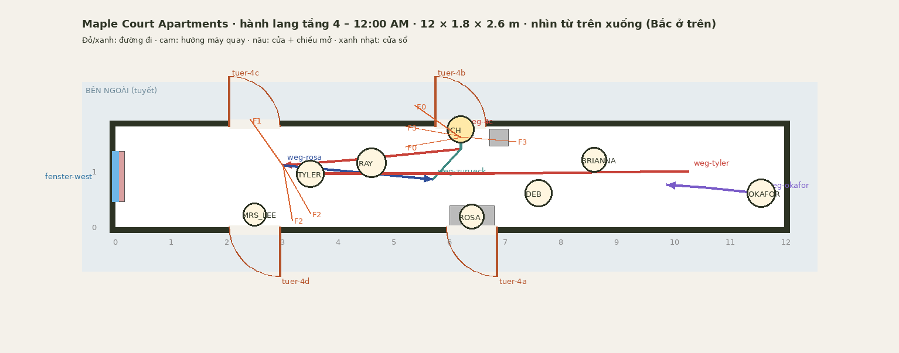

# Mặt bằng: Maple Court Apartments · hành lang tầng 4 – 12:00 AM

> File này được **sinh tự động** từ `plan.json` bởi `scripts/plan_tool.py`. Muốn sửa thì sửa `plan.json` rồi chạy lại công cụ.

## Kết quả kiểm tra

✅ Không có va chạm: không đường đi nào xuyên tường hay đồ đạc, cửa mở không va đồ, máy quay không nằm trong vật thể.

## Kích thước & hệ toạ độ

- Kích thước phòng: **12,00 m (rộng, Tây→Đông) × 1,80 m (sâu, Nam→Bắc) × 2,60 m (cao)**
- Gốc toạ độ: Góc Tây-Nam hành lang (sàn tầng 4 = 0). x về phía Đông, y về phía Bắc. Căn 4B: góc Tây-Nam của nó ở (5,0; 1,95).
- Hướng máy quay (yaw): 0° = Bắc (dãy cửa 4C, 4B), +90° = Đông (cầu thang), −90° = Tây (cửa sổ cuối hành lang, cửa thoát hiểm), ±180° = Nam (cửa 4D, 4A)

## Tường

| ID | Tường | Từ → Đến (m) | Dày | Vật liệu | Ghi chú |
|---|---|---|---|---|---|
| nord | Tường Bắc (dãy 4C – 4B) | (0,00; 1,80) → (12,00; 1,80) | 0,15 m | thạch cao, giấy dán tường sọc xanh rêu đã bong mép, ván chân tường gỗ sẫm | Đèn tường hình nến đồng giữa các cửa (x = 4,2 và 8,0), cao 1,9 m; đèn ở x = 4,2 chập chờn |
| sued | Tường Nam (dãy 4D – 4A) | (0,00; 0,00) → (12,00; 0,00) | 0,15 m | như tường Bắc | Hộp bình chữa cháy treo tường ở x = 8,8, cao 1,2 m |
| west | Đầu Tây | (0,00; 0,00) → (0,00; 1,80) | 0,30 m | gạch | Cửa sổ nhìn ra con hẻm, đèn EXIT đỏ phía trên cửa thoát hiểm |
| ost | Đầu Đông (giếng cầu thang) | (12,00; 0,00) → (12,00; 1,80) | 0,15 m | thạch cao | Cầu thang gỗ đi xuống tầng 3 chiếm x 10,4–12,0 |

## Cửa ra vào

| ID | Tường | Vị trí (tâm) | Rộng × cao | Bản lề | **Hướng mở** | Ghi chú |
|---|---|---|---|---|---|---|
| tuer-4c | nord | x = 2,50 m | 0,90 × 2,03 m | phía Tây | **vào trong căn 4C** | MỐI NGUY. Sơn nâu như 4B nhưng bụi phủ khung cửa và số '4C' – CHỈ tay nắm sạch bóng. Ổ khoá móc mới tinh (bạc, sáng) trên chốt hasp. Khe dưới cửa: ánh sáng xanh lạnh chập chờn như màn hình; tắt ở 75,3 s. Phía sau: căn 4C (không thấy trong tập 1). |
| tuer-4b | nord | x = 6,20 m | 0,90 × 2,03 m | phía Tây | **vào trong căn 4B** | Cửa của TÔI. Đôi giày thể thao trắng của Jenna vẫn để trên thảm chùi chân bên phải cửa (gieo cho câu 'Jenna left her…'). |
| tuer-4d | sued | x = 2,50 m | 0,90 × 2,03 m | phía Đông | **vào trong căn 4D** | Bà Lee (MRS_LEE). Đối diện 4C. Mở he hé từ 75,5 s. |
| tuer-4a | sued | x = 6,40 m | 0,90 × 2,03 m | phía Đông | **vào trong căn 4A** | Rosa. Mở hé có xích (khe 12 cm) ở 37,0 s, đóng ở 53,8 s, mở lại (bỏ xích) ở 76 s. Sau khe: hành lang nhỏ nhà Rosa, đèn vàng, ảnh Đức Mẹ, con mèo mướp Pickle (của Jenna) đi ngang. |

## Cửa sổ

| ID | Tường | Vị trí (tâm) | Rộng × cao | Bậu cửa | Cách mở | Nhìn ra |
|---|---|---|---|---|---|---|
| fenster-west | west | y = 0,90 m | 0,90 × 1,20 m | 0,95 m | Cửa sổ kéo, đóng | Con hẻm, cầu thang thoát hiểm bằng sắt bên ngoài, tuyết lất phất dưới đèn đường |

## Cầu thang

- Cầu thang gỗ ở đầu Đông (x 10,4–12,0, cả bề ngang 1,8 m): 16 bậc đi XUỐNG tầng 3, chiếu nghỉ giữa; lan can gỗ phía Bắc. Hàng xóm tầng 3 (Okafor, Ray, Tyler, Brianna, Deb) đi lên từ đây sau tiếng 'rầm' – đầu họ nhô lên trước, từng bậc một.

## Đồ nội thất (từng món)

| ID | Loại | x từ–đến (m) | y từ–đến (m) | Cao | Ghi chú |
|---|---|---|---|---|---|
| heizkoerper | Lò sưởi gang dưới cửa sổ | 0,02–0,16 | 0,45–1,35 | 0,65 m | Kêu lách cách (nguồn thấy được) – chỉ khi trong khung |
| schuhe-jenna | Đôi giày của Jenna trên thảm chùi chân | 6,72–7,06 | 1,45–1,75 | 0,12 m | Giày thể thao trắng có dây hồng, bụi phủ. Không cản lối đi của TÔI. |
| fussmatte-4a | Thảm chùi chân 'BIENVENIDOS' | 6,00–6,80 | 0,02–0,37 | 0,01 m |  |

## Nhân vật & vị trí

| Nhân vật | Figur | Vị trí (x; y) | Chỗ | Bán kính thân | Ghi chú |
|---|---|---|---|---|---|
| ICH | pov | (6,20; 1,75) | đứng | 0,25 m | Ra khỏi 4B lúc 31,3 s; về lại 4B lúc 54,6 s; đứng ở ngưỡng cửa 4B từ 76,5 s. |
| ROSA | rosa | (6,40; 0,18) | đứng | 0,23 m | Đứng sau khe cửa có xích của 4A (37,0–53,8 s): chỉ thấy nửa mặt, lô cuốn tóc, tay đưa vòng cổ mèo qua khe. Từ 76 s mở hẳn cửa, đứng ở ngưỡng. |
| MRS_LEE | mrs-lee | (2,50; 0,22) | đứng | 0,21 m | Bà cụ 4D, ló ra ở cửa đối diện 4C, tay nắm chặt cổ áo choàng. Không bước ra. |
| TYLER | tyler | (3,50; 0,95) | đứng | 0,25 m | Lên cầu thang trước nhất, chạy về phía 4C rồi khựng lại cách cửa 1 m (người đứng sững). |
| RAY | ray | (4,60; 1,15) | đứng | 0,27 m | Đứng giữa hành lang, chống nạnh, gọi điện; ở 'Should we knock?' bước nửa bước về 4C (người muốn giúp). |
| DEB | deb | (7,60; 0,60) | đứng | 0,25 m | Đứng gần 4A cạnh Rosa, tay đặt lên vai Rosa; nhìn TÔI ('Look at him'). |
| BRIANNA | brianna | (8,60; 1,20) | đứng | 0,23 m | Đứng gần đầu cầu thang, ôm điện thoại, lùi dần về phía cầu thang (người muốn chạy). |
| OKAFOR | okafor | (11,60; 0,60) | đứng | 0,26 m | Lên cầu thang chậm, tay vịn lan can; dừng ở đầu cầu thang. |

## Đường di chuyển

Mỗi đường được kiểm tra theo từng cm, tính cả bán kính thân người: không được chạm tường (trừ khi đi qua cửa) và không được chạm đồ đạc.

| ID | Ai | Câu thoại | Thời gian | Các điểm (x; y) | Dài | Kiểm tra | Mô tả |
|---|---|---|---|---|---|---|---|
| weg-4c | ICH | 08–09 | 34,9–37,1 s | (6,20; 1,75) → (6,20; 1,40) → (4,20; 1,20) → (3,00; 1,10) | 3,56 m | ✅ | Đi nhanh, khom người về phía 4C, 5 bước trên thảm cũ (có tiếng bước chân). Dừng cách cửa 4C 0,7 m. |
| weg-rosa | ICH | 10–11 | 41,4–43,3 s | (3,00; 1,10) → (4,60; 0,95) → (5,70; 0,85) | 2,71 m | ✅ | Nghe tiếng xích, quay lại, bước về phía cửa 4A của Rosa. Dừng cách khe cửa 0,7 m. |
| weg-zurueck | ICH | 13–14 | 60,2–61,0 s | (5,70; 0,85) → (6,20; 1,40) → (6,20; 1,75) | 1,09 m | ✅ | Rosa đóng cửa; TÔI quay về 4B (2 bước, tiếp tục trong sơ đồ 4B). |
| weg-okafor | OKAFOR | M01–M14 | 85,9–90,9 s | (11,60; 0,60) → (10,60; 0,70) → (9,90; 0,75) | 1,71 m | ✅ | Lên những bậc cuối, dừng ở đầu cầu thang. |
| weg-tyler | TYLER | M04 | 84,9–86,9 s | (10,30; 1,00) → (6,80; 0,95) → (3,50; 0,95) | 6,80 m | ✅ | Chạy từ cầu thang qua trước cửa 4B (TÔI vẫn đang ở trong ngưỡng cửa, y ≥ 1,8) tới gần 4C. |

## Vị trí máy quay theo từng góc quay

Toàn bộ là góc nhìn thứ nhất (POV) với ống kính fisheye 0.5x (góc ngang 120°).

| Góc | Câu | Thời gian | Vị trí (x; y; z) | Yaw | Pitch | FOV | Nhân vật trong khung | Thấy gì | Tay làm gì |
|---|---|---|---|---|---|---|---|---|---|
| F0 | (khoảng lặng trước 09) | 34,9–37,2 s | (6,20; 1,60; 1,60) | -100° → -55° | -5° | 115° | MRS_LEE (-110°), TYLER (-104°), RAY (-106°) | Ra khỏi 4B, đi nhanh về phía 4C: cửa 4C dần vào GIỮA KHUNG; bước chân trên thảm, camera nhún. | Tay trái kéo cửa 4B khép hờ sau lưng rồi vung theo bước; tay phải điện thoại bật đèn pin chiếu về phía trước. |
| F1 | 09 | 37,2–40,7 s | (3,00; 1,10; 1,60) | -35° → -35° | -12° | 115° | – | GIỮA KHUNG: cửa 4C – tay nắm sạch bóng giữa lớp bụi, ổ khoá móc mới tinh, khe sáng xanh dưới cửa. Camera nhìn xuống khe cửa rồi lên tay nắm. | Tay phải chìa ra gần tay nắm nhưng không chạm; tay trái điện thoại bật đèn pin chiếu vào ổ khoá. |
| F2 | 10–13 | 40,7–61,0 s | (3,00; 1,10; 1,60) | +150° → +170° | -3° | 115° | ROSA (+105°), MRS_LEE (-150°), TYLER (+107°), DEB (+96°), OKAFOR (+93°) | GIỮA KHUNG: khe cửa có xích của 4A, nửa mặt Rosa. 46–49 s: tay Rosa đưa vòng cổ mèo 'PICKLE – 4B' qua khe (cận). Cửa 4C ở mép phải khung khi TÔI ngoái lại (~44 s) – ánh xanh dưới khe vẫn sáng. | Tay trái giơ điện thoại hạ đèn pin xuống sàn (lịch sự), tay phải đỡ lấy vòng cổ mèo. |
| F3 | 19–21 + M01–M20 + thẻ kết | 86,5–105,4 s | (6,20; 1,62; 1,60) | -80° → +95° | +0° | 115° | MRS_LEE (-111°), TYLER (-104°), RAY (-106°), DEB (+126°), BRIANNA (+100°), OKAFOR (+101°) | 76,5–80: GIỮA KHUNG cửa 4C (yaw −80): khe sáng xanh TẮT; bà Lee ló ra ở 4D, Tyler chạy qua rồi khựng trước 4C. 80–84: lia sang Đông (yaw +95): Ray, Deb cạnh Rosa, Brianna, Okafor ở đầu cầu thang, mọi người mặc đồ ngủ, đèn tường chập chờn. 84–87,8: cúi xuống điện thoại – các mạng '4C_CAM_…' biến mất từng cái; ngẩng lên lại cửa 4C ở GIỮA KHUNG. 87,8–93,8: thẻ kết phủ mờ lên cảnh hành lang (hàng xóm vẫn trong hình, tiếng xì xào tiếp tục). | Tay trái nắm khung cửa 4B (đứng ở ngưỡng), tay phải điện thoại bật loa gọi 911. |

## Bên ngoài

- **thời gian:** 12:00 AM, cuối tháng 11
- **ánh sáng:** Hai đèn tường hình nến đồng (vàng đục), đèn ở x = 4,2 chập chờn; đèn EXIT đỏ ở đầu Tây; ánh xanh lạnh từ khe dưới cửa 4C (tắt ở 75,3 s); đèn pin điện thoại của TÔI
- **mặt sàn:** Thảm hành lang đỏ sẫm, sờn thành vệt ở giữa; bước chân trầm, có tiếng sàn gỗ kêu dưới thảm
- **tầm nhìn:** Từ (3,0; 1,1): cửa 4C yaw ≈ −35°; cửa 4A yaw ≈ +150°. Từ ngưỡng cửa 4B (6,2; 1,62): cửa 4C yaw ≈ −83°, cầu thang yaw ≈ +95°
