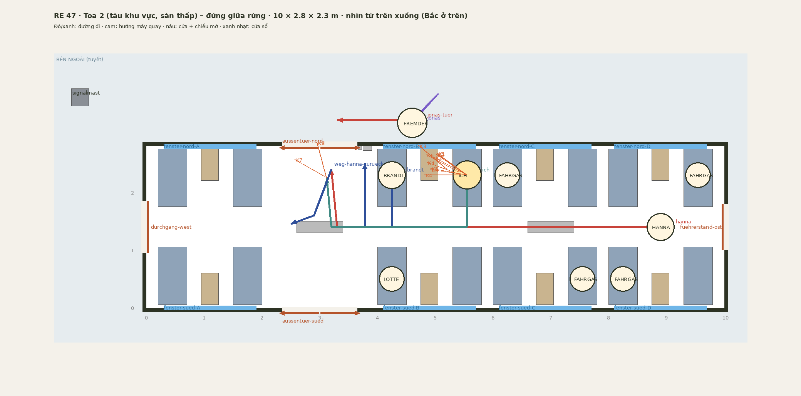
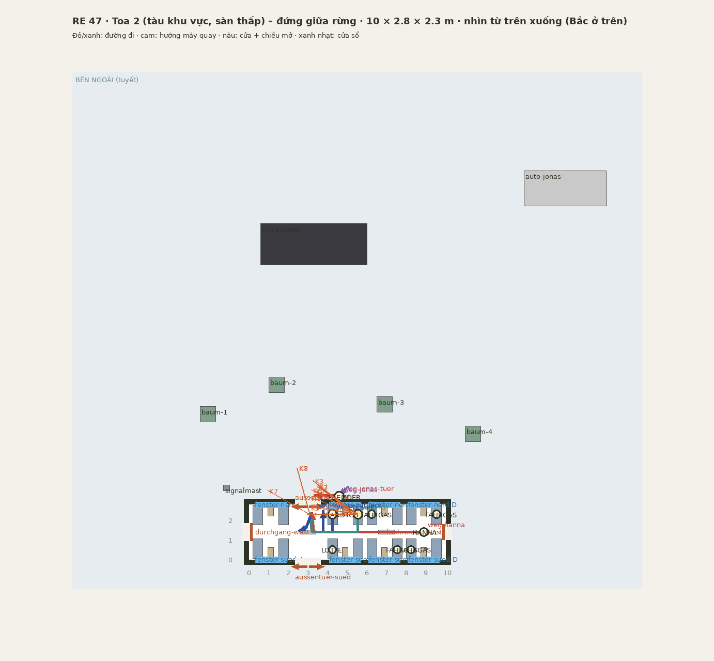

# Mặt bằng: RE 47 · Toa 2 (tàu khu vực, sàn thấp) – đứng giữa rừng

> File này được **sinh tự động** từ `plan.json` bởi `scripts/plan_tool.py`. Muốn sửa thì sửa `plan.json` rồi chạy lại công cụ.

## Kết quả kiểm tra

✅ Không có va chạm: không đường đi nào xuyên tường hay đồ đạc, cửa mở không va đồ, máy quay không nằm trong vật thể.

## Kích thước & hệ toạ độ

- Kích thước phòng: **10,00 m (rộng, Tây→Đông) × 2,80 m (sâu, Nam→Bắc) × 2,30 m (cao)**
- Gốc toạ độ: Góc Tây-Nam trong toa (sàn toa = 0). x dọc toa về phía Đông (đuôi tàu), y ngang toa về phía Bắc (phía rừng/Jonas), z lên. Mặt tuyết bên ngoài ở z = −0,60 m.
- Hướng máy quay (yaw): 0° = Bắc (nhìn ra cửa sổ phía rừng), +90° = Đông (đuôi toa), −90° = Tây (về khu cửa và toa 1)

## Tường

| ID | Tường | Từ → Đến (m) | Dày | Vật liệu | Ghi chú |
|---|---|---|---|---|---|
| nord | Thành Bắc (phía rừng, Jonas đứng ngoài) | (0,00; 2,80) → (10,00; 2,80) | 0,08 m | nhôm, ốp nhựa xám nhạt | 4 cửa sổ + cửa lên xuống; kính đóng băng ở mép |
| sued | Thành Nam (phía đường ray thứ hai) | (0,00; 0,00) → (10,00; 0,00) | 0,08 m | nhôm, ốp nhựa xám nhạt | 4 cửa sổ + cửa lên xuống (đối diện) |
| west | Vách đầu Tây (sang toa 1) | (0,00; 0,00) → (0,00; 2,80) | 0,08 m | vách nhựa, cửa kính | Cửa thông sang toa 1 |
| ost | Vách đầu Đông (buồng lái phía sau) | (10,00; 0,00) → (10,00; 2,80) | 0,08 m | vách nhựa | Cửa buồng lái sau – khoá |

## Cửa ra vào

| ID | Tường | Vị trí (tâm) | Rộng × cao | Bản lề | **Hướng mở** | Ghi chú |
|---|---|---|---|---|---|---|
| aussentuer-nord | nord | x = 3,00 m | 1,30 × 1,95 m | không bản lề (2 cánh trượt) | **bật ra ngoài 5 cm rồi trượt dọc thân toa (cánh Tây về Tây, cánh Đông về Đông) – KHÔNG quay vào trong** | Ô kính 0,5 × 0,9 m trên mỗi cánh, mép dưới cao 0,85 m; đang khoá (mất điện), chỉ mở được bằng Notentriegelung |
| aussentuer-sued | sued | x = 3,00 m | 1,30 × 1,95 m | không bản lề (2 cánh trượt) | **bật ra ngoài rồi trượt dọc thân toa – KHÔNG quay vào trong** | Cửa đối diện, nhìn ra rừng tối; không dùng trong tập 1 |
| durchgang-west | west | y = 1,40 m | 0,90 × 1,95 m | không bản lề (1 cánh trượt) | **trượt vào trong vách về phía Nam** | Cửa kính sang toa 1 (toa 1 trống, tối) |
| fuehrerstand-ost | ost | y = 1,40 m | 0,80 × 1,95 m | không bản lề (1 cánh trượt) | **trượt vào vách về phía Bắc** | Buồng lái phía sau – khoá |

## Cửa sổ

| ID | Tường | Vị trí (tâm) | Rộng × cao | Bậu cửa | Cách mở | Nhìn ra |
|---|---|---|---|---|---|---|
| fenster-nord-A | nord | x = 1,10 m | 1,60 × 0,95 m | 0,75 m | Kính cố định, không mở được | Rừng tuyết ban đêm, đường lâm nghiệp phía xa |
| fenster-nord-B | nord | x = 4,90 m | 1,60 × 0,95 m | 0,75 m | Kính cố định, không mở được | Rừng tuyết ban đêm, đường lâm nghiệp phía xa |
| fenster-nord-C | nord | x = 6,90 m | 1,60 × 0,95 m | 0,75 m | Kính cố định, không mở được | Rừng tuyết ban đêm, đường lâm nghiệp phía xa |
| fenster-nord-D | nord | x = 8,90 m | 1,60 × 0,95 m | 0,75 m | Kính cố định, không mở được | Rừng tuyết ban đêm, đường lâm nghiệp phía xa |
| fenster-sued-A | sued | x = 1,10 m | 1,60 × 0,95 m | 0,75 m | Kính cố định, không mở được | Đường ray thứ hai, rừng tối |
| fenster-sued-B | sued | x = 4,90 m | 1,60 × 0,95 m | 0,75 m | Kính cố định, không mở được | Đường ray thứ hai, rừng tối |
| fenster-sued-C | sued | x = 6,90 m | 1,60 × 0,95 m | 0,75 m | Kính cố định, không mở được | Đường ray thứ hai, rừng tối |
| fenster-sued-D | sued | x = 8,90 m | 1,60 × 0,95 m | 0,75 m | Kính cố định, không mở được | Đường ray thứ hai, rừng tối |

## Cầu thang

- Bậc lên xuống ngoài cửa Bắc: bậc gập (đang thu vào), mép dưới cửa cao 0,60 m so với mặt tuyết – Jonas đứng dưới, đầu ngang ô kính dưới

## Đồ nội thất (từng món)

| ID | Loại | x từ–đến (m) | y từ–đến (m) | Cao | Ghi chú |
|---|---|---|---|---|---|
| bank-A-w-n | Ghế băng đôi | 0,20–0,70 | 1,75–2,75 | 1,05 m | chỗ ngồi (0,45; 2,30) |
| tisch-A-n | Bàn gập nhỏ (gắn tường) | 0,95–1,25 | 2,20–2,75 | 0,72 m | gắn vào thành toa dưới cửa sổ |
| bank-A-o-n | Ghế băng đôi | 1,50–2,00 | 1,75–2,75 | 1,05 m | chỗ ngồi (1,75; 2,30) |
| bank-A-w-s | Ghế băng đôi | 0,20–0,70 | 0,05–1,05 | 1,05 m | chỗ ngồi (0,45; 0,50) |
| tisch-A-s | Bàn gập nhỏ (gắn tường) | 0,95–1,25 | 0,05–0,60 | 0,72 m | gắn vào thành toa dưới cửa sổ |
| bank-A-o-s | Ghế băng đôi | 1,50–2,00 | 0,05–1,05 | 1,05 m | chỗ ngồi (1,75; 0,50) |
| bank-B-w-n | Ghế băng đôi | 4,00–4,50 | 1,75–2,75 | 1,05 m | chỗ ngồi (4,25; 2,30) |
| tisch-B-n | Bàn gập nhỏ (gắn tường) | 4,75–5,05 | 2,20–2,75 | 0,72 m | gắn vào thành toa dưới cửa sổ |
| bank-B-o-n | Ghế băng đôi | 5,30–5,80 | 1,75–2,75 | 1,05 m | chỗ ngồi (5,55; 2,30) |
| bank-B-w-s | Ghế băng đôi | 4,00–4,50 | 0,05–1,05 | 1,05 m | chỗ ngồi (4,25; 0,50) |
| tisch-B-s | Bàn gập nhỏ (gắn tường) | 4,75–5,05 | 0,05–0,60 | 0,72 m | gắn vào thành toa dưới cửa sổ |
| bank-B-o-s | Ghế băng đôi | 5,30–5,80 | 0,05–1,05 | 1,05 m | chỗ ngồi (5,55; 0,50) |
| bank-C-w-n | Ghế băng đôi | 6,00–6,50 | 1,75–2,75 | 1,05 m | chỗ ngồi (6,25; 2,30) |
| tisch-C-n | Bàn gập nhỏ (gắn tường) | 6,75–7,05 | 2,20–2,75 | 0,72 m | gắn vào thành toa dưới cửa sổ |
| bank-C-o-n | Ghế băng đôi | 7,30–7,80 | 1,75–2,75 | 1,05 m | chỗ ngồi (7,55; 2,30) |
| bank-C-w-s | Ghế băng đôi | 6,00–6,50 | 0,05–1,05 | 1,05 m | chỗ ngồi (6,25; 0,50) |
| tisch-C-s | Bàn gập nhỏ (gắn tường) | 6,75–7,05 | 0,05–0,60 | 0,72 m | gắn vào thành toa dưới cửa sổ |
| bank-C-o-s | Ghế băng đôi | 7,30–7,80 | 0,05–1,05 | 1,05 m | chỗ ngồi (7,55; 0,50) |
| bank-D-w-n | Ghế băng đôi | 8,00–8,50 | 1,75–2,75 | 1,05 m | chỗ ngồi (8,25; 2,30) |
| tisch-D-n | Bàn gập nhỏ (gắn tường) | 8,75–9,05 | 2,20–2,75 | 0,72 m | gắn vào thành toa dưới cửa sổ |
| bank-D-o-n | Ghế băng đôi | 9,30–9,80 | 1,75–2,75 | 1,05 m | chỗ ngồi (9,55; 2,30) |
| bank-D-w-s | Ghế băng đôi | 8,00–8,50 | 0,05–1,05 | 1,05 m | chỗ ngồi (8,25; 0,50) |
| tisch-D-s | Bàn gập nhỏ (gắn tường) | 8,75–9,05 | 0,05–0,60 | 0,72 m | gắn vào thành toa dưới cửa sổ |
| bank-D-o-s | Ghế băng đôi | 9,30–9,80 | 0,05–1,05 | 1,05 m | chỗ ngồi (9,55; 0,50) |
| notentriegelung | Tay nắm mở cửa khẩn cấp (Notentriegelung) | 3,75–3,90 | 2,72–2,80 | 1,35 m | Hộp đỏ có nắp nhựa, gắn tường Bắc cạnh cửa, cao 1,15–1,35 m; kéo xuống → cửa mở khi tàu đứng |
| tueroeffner-innen | Nút mở cửa (bên trong) | 3,67–3,73 | 2,74–2,80 | 1,10 m | Nút tròn phát sáng xanh; bị khoá vì mất điện |
| notlicht-1 | Đèn khẩn cấp (trần) | 2,60–3,40 | 1,30–1,50 | 2,30 m | Dải đèn cam mờ – nguồn sáng duy nhất trong toa |
| notlicht-2 | Đèn khẩn cấp (trần) | 6,60–7,40 | 1,30–1,50 | 2,30 m | Dải đèn cam mờ |

## Nhân vật & vị trí

| Nhân vật | Figur | Vị trí (x; y) | Chỗ | Bán kính thân | Ghi chú |
|---|---|---|---|---|---|
| ICH | pov | (5,55; 2,30) | bank-B-o-n | 0,25 m | Ngồi ghế băng Đông khoang B, sát cửa sổ, quay mặt về phía Tây (thấy Brandt và cửa); tầm mắt ngồi 1,20 m |
| BRANDT | brandt | (4,25; 2,30) | bank-B-w-n | 0,24 m | Ngồi đối diện ICH, lưng quay về cửa; điện thoại để trên bàn tisch-B-n |
| LOTTE | lotte | (4,25; 0,50) | bank-B-w-s | 0,22 m | Ngồi chéo bên kia lối đi, quay mặt về phía Đông, điện thoại livestream |
| HANNA | hanna | (8,90; 1,40) | đứng | 0,24 m | Trưởng tàu: đi từ cuối toa lên, đứng sát cửa Bắc (beat 1–4), lùi về lối đi phía Tây (beat 5) |
| FREMDER | jonas | (4,60; 3,20) | đứng | 0,26 m | Jonas, NGOÀI toa trong tuyết, đập vào cửa sổ khoang B ngay cạnh ICH; từ beat 5 chạy sang cánh Đông của cửa Bắc. Mặt đất thấp hơn sàn toa 0,6 m |
| FAHRGAST_A | – | (6,25; 2,30) | ngoài khung hình | 0,22 m | Chỉ có giọng – ngồi khoang C sau lưng máy quay |
| FAHRGAST_B | – | (7,55; 0,50) | ngoài khung hình | 0,22 m | Chỉ có giọng – khoang C |
| FAHRGAST_C | – | (8,25; 0,50) | ngoài khung hình | 0,22 m | Chỉ có giọng – khoang D |
| FAHRGAST_D | – | (9,55; 2,30) | ngoài khung hình | 0,22 m | Chỉ có giọng – khoang D |

## Xoay người khi ngồi

Khi ngồi chỉ xoay đầu/thân trên – chân giữ trong khoảng giữa hai ghế băng.

- **BRANDT:** B1–B4: quay đầu ra sau nhìn cửa (thân trên tối đa 70°)
- **LOTTE:** Quay đầu sang ICH và ra cửa, cầm điện thoại livestream

## Đường di chuyển

Mỗi đường được kiểm tra theo từng cm, tính cả bán kính thân người: không được chạm tường (trừ khi đi qua cửa) và không được chạm đồ đạc.

| ID | Ai | Câu thoại | Thời gian | Các điểm (x; y) | Dài | Kiểm tra | Mô tả |
|---|---|---|---|---|---|---|---|
| weg-hanna | HANNA | 04 | 9,3–13,3 s | (8,90; 1,40) → (3,30; 1,40) → (3,20; 2,40) | 6,60 m | ✅ | Từ cuối toa dọc lối giữa lên khu cửa, đứng sát cửa Bắc nhìn ra, nói vào bộ đàm |
| weg-brandt | BRANDT | 24 | 81,2–84,4 s | (4,25; 2,30) → (4,25; 1,40) → (3,78; 1,40) → (3,78; 2,50) | 2,47 m | ✅ | Đứng dậy, ra lối đi, đến đứng cạnh cửa, tay đặt lên Notentriegelung |
| weg-ich | ICH | 32–35 | 110,0–117,1 s | (5,55; 2,30) → (5,55; 1,40) → (3,20; 1,40) → (3,12; 2,25) | 4,10 m | ✅ | ICH đứng dậy, đi đến cửa (đứng cạnh Brandt) – máy quay đi theo |
| weg-jonas | FREMDER | 15 | 48,0–52,1 s | (4,60; 3,20) → (5,05; 3,70) → (4,60; 3,25) | 1,31 m | ✅ | Lùi ra, ném kìm cộng lực vào tuyết, quay lại cửa sổ B |
| weg-jonas-tuer | FREMDER | 25–26 | 86,6–89,1 s | (4,60; 3,25) → (3,30; 3,25) | 1,30 m | ✅ | Thấy Brandt ở tay nắm cửa → chạy sang cánh Đông của cửa Bắc, đập vào kính cửa |
| weg-hanna-zurueck | HANNA | 24 | 81,7–83,7 s | (3,20; 2,40) → (2,90; 1,60) → (2,50; 1,45) | 1,28 m | ✅ | Lùi khỏi cửa khi Brandt đặt tay lên Notentriegelung – chừa chỗ cho Brandt và sau đó ICH |

## Vị trí máy quay theo từng góc quay

Toàn bộ là góc nhìn thứ nhất (POV) với ống kính fisheye 0.5x (góc ngang 120°).

| Góc | Câu | Thời gian | Vị trí (x; y; z) | Yaw | Pitch | FOV | Nhân vật trong khung | Thấy gì | Tay làm gì |
|---|---|---|---|---|---|---|---|---|---|
| K1 | 01–07 | 0,0–26,0 s | (5,55; 2,30; 1,20) | -54° | +0° | 115° | BRANDT (-90°), FREMDER (-47°) | GIỮA KHUNG: Jonas đập tay vào cửa sổ khoang B ngay cạnh ICH (thấy từ khung hình 0); cửa đỏ và Brandt (lưng quay ra cửa) bên trái | Tay phải giơ điện thoại bật đèn pin chiếu vào ô kính; tay trái bám mép bàn |
| K2 | 08–12 | 26,0–43,3 s | (5,55; 2,30; 1,20) | -56° → -62° | +0° | 115° | BRANDT (-90°), FREMDER (-47°) | GIỮA KHUNG: Jonas sau cửa sổ B; Hanna cầm bộ đàm ở khu cửa (trái), Brandt gần | Điện thoại quay phim (chấm đỏ REC), tay trái xoay theo |
| K3 | 13–17 | 43,3–58,4 s | (5,20; 2,40; 1,25) | -50° | -3° | 115° | BRANDT (-96°), FREMDER (-37°) | GIỮA KHUNG: Jonas giơ kìm cộng lực sau cửa sổ B, rồi lùi ra ném vào tuyết | Tay trái chống lên kính cửa sổ khoang B, tay phải đèn pin |
| K4 | 18–23 | 58,4–81,2 s | (5,45; 2,30; 1,20) | -70° → -90° | -32° | 115° | BRANDT (-90°), LOTTE (-146°), FREMDER (-43°) | GIỮA KHUNG: điện thoại của Brandt trên bàn sáng lên „Zug steht. Halt sie drinnen.“ → ngẩng lên mặt Brandt | Tay trái với về phía điện thoại của Brandt, rụt lại khi Brandt nói „leg das Handy weg“ |
| K5 | 24–26 | 81,2–94,4 s | (5,55; 2,30; 1,20) | -80° → -82° | +0° | 115° | BRANDT (-90°), FREMDER (-47°) | GIỮA KHUNG: Brandt đứng cạnh cửa, tay trên hộp đỏ Notentriegelung; Jonas chạy sang cửa | Điện thoại hạ thấp, tay run |
| K6 | 27–31 | 94,4–110,0 s | (5,40; 2,35; 1,20) | -62° | -2° | 115° | BRANDT (-92°), FREMDER (-43°) | GIỮA KHUNG: mặt Jonas sát kính cánh cửa Đông, môi tím, tuyết bám; Brandt quay lại nhìn con | Đèn pin chiếu vào Jonas, tay trái nắm chặt mép bàn |
| K7 | 32–35 | 110,0–126,7 s | (3,12; 2,25; 1,60) | -60° → -15° | -4° | 115° | – | ICH đi tới cửa (máy quay theo weg-ich). GIỮA KHUNG: ô kính cửa – Jonas phía dưới, xa xa chiếc xe tải không đèn trên đường rừng | Tay trái bám lưng ghế khi đi, rồi đặt lên mép cửa; tay phải cầm điện thoại có chat „Wir sehen euch. Wagen zwei.“ |
| K8 | thẻ kết | 126,7–134,2 s | (3,12; 2,25; 1,60) | -15° | -6° | 115° | – | Hình dừng mờ: cửa + Jonas + xe tải; thẻ „Was würdest du tun?“ A/B | Tay phải lơ lửng ngay trên hộp Notentriegelung (lựa chọn) |

## Vật thể bên ngoài

| ID | Loại | x từ–đến (m) | y từ–đến (m) | Cao | Ghi chú |
|---|---|---|---|---|---|
| signalmast | Cột tín hiệu (tắt) | -1,30–-1,00 | 3,50–3,80 | 4,50 m | Đèn tín hiệu tối – vì cáp đã bị cắt |
| baum-1 | Cây vân sam phủ tuyết | -2,50–-1,70 | 7,00–7,80 | 12,00 m |  |
| baum-2 | Cây vân sam phủ tuyết | 1,00–1,80 | 8,50–9,30 | 14,00 m |  |
| baum-3 | Cây vân sam phủ tuyết | 6,50–7,30 | 7,50–8,30 | 13,00 m |  |
| baum-4 | Cây vân sam phủ tuyết | 11,00–11,80 | 6,00–6,80 | 12,00 m |  |
| auto-jonas | Xe ô tô của Jonas (kẹt tuyết, không thấy trong tập 1) | 14,00–18,20 | 18,00–19,80 | 1,50 m | Chỉ nhắc trong lời thoại |
| transporter | Xe tải nhỏ không đèn (băng trộm cáp) | 0,60–6,00 | 15,00–17,10 | 2,40 m | Xuất hiện trên đường rừng từ 111,4 s; trước đó không có; đứng ngay sau Jonas khi nhìn từ cửa Bắc |

## Bên ngoài

- **thời gian:** 02:00 đêm, bão tuyết nhẹ, −15 °C; tuyết rơi chéo từ Tây sang Đông
- **ánh sáng:** Trong toa chỉ có 2 dải đèn khẩn cấp màu cam; ngoài trời tối xanh, tuyết phản sáng nhẹ; đèn pin điện thoại của ICH là nguồn sáng chính hướng vào Jonas
- **mặt đất:** Taluy tuyết dốc nhẹ từ thân toa ra 4 m, sau đó rừng vân sam; đường lâm nghiệp chạy song song cách toa ≈ 15–17 m
- **xe tải:** Xe tải nhỏ màu than chì, KHÔNG bật đèn, dừng trên đường rừng từ beat 7
- **tầm nhìn:** Từ ghế ICH: Jonas ở cửa sổ B yaw ≈ −54°, cửa Bắc yaw ≈ −79°; khi ICH đứng ở cửa (3,12; 2,25): Jonas yaw ≈ +10°, xe tải yaw ≈ +2° (ngay phía sau Jonas)
